  

  

## 我在做什么

**把重复的平台操作，变成可编排的命令行。**

不是爬虫，也不止是给平台套一层 AI。自研 **Bridge Framework** 驱动真实浏览器，让脚本拥有状态、让 AI 拥有手 —— 搜索、浏览、发布、回复、录制、剪辑，都能在终端里完成。

从抖音评论运营，到直播高光自动切片，再到让 Agent 拥有跨项目的记忆。工具应该比它操作的平台活得更久。

## 代表项目

| 项目 | 简介 | ★ |
|:--|:--|--:|
| **[douyin-cli](https://github.com/CipherNoct/douyin-cli)** | 抖音评论运营 CLI —— 全量评论、AI 人格化回复、草稿管理与风控 |  |
| **[douyin-living](https://github.com/CipherNoct/douyin-living)** | 直播全自动录制 + 多模态 AI 切片 —— 录制 → 弹幕 → ASR → 高光 |  |
| **[xiaohongshu-cli](https://github.com/CipherNoct/xiaohongshu-cli)** | 小红书全自动管理 —— 搜索、全量评论、AI 智能回复、运营仪表盘 |  |
| **[BossZhipin-cli](https://github.com/CipherNoct/BossZhipin-cli)** | BOSS 直聘命令行工具 —— 智能匹配、LLM 打招呼、17 条命令 |  |
| **[my-claude-memory](https://github.com/CipherNoct/my-claude-memory)** | Agent 分层记忆 —— 跨会话、跨项目、跨机器共享上下文 |  |

还有：[tiktok-cli](https://github.com/CipherNoct/tiktok-cli) · [ths-cli](https://github.com/CipherNoct/ths-cli) · [markdown-to](https://github.com/CipherNoct/markdown-to)

## 正在构建

| 层 | 内容 |
|:--|:--|
| **Runtime** | Bridge Framework —— 真实浏览器上的可编程运行时，已支撑 6 个平台工具 |
| **Intelligence** | LLM 人格化回复、多模态高光判断、ASR 信号融合 |
| **Memory** | my-claude-memory —— 让 Agent 跨会话、跨项目、跨机器记住上下文 |

## 工作方式

**01 / 真实优先** —— 真实浏览器与真实行为，换取长期可用性。

**02 / AI 是操作员** —— 不止生成文案，而是跑完整个流程。

**03 / 工具即积木** —— 单用是 CLI，组合起来是系统。

---

BUILD THINGS THAT OUTLIVE THEIR INTERFACES.
  
<a href="https://github.com/CipherNoct">github.com/CipherNoct</a>

