  

  

<table>
<tr>
<td width="235" valign="top">
  
</td>
<td valign="top">
  <h3>独立开发者 · 构建 AI 原生的自动化工具集</h3>
  
<strong>把重复的平台操作，变成可编排的命令行。</strong>

  
不是爬虫，也不止是给平台套一层 AI。自研 <strong>Bridge Framework</strong> 驱动真实浏览器，让脚本拥有状态、让 AI 拥有手 —— 搜索、浏览、发布、回复、录制、剪辑，都能在终端里完成。

  
从抖音评论运营，到直播高光自动切片，再到让 Agent 拥有跨项目的记忆。工具应该比它操作的平台活得更久。

</td>
</tr>
</table>

> **Now** — building Bridge Framework, a programmable runtime on real browsers. 
> **Focus** — agent memory · multimodal pipelines · CLI orchestration. 
> **Belief** — tools should outlive the interfaces they operate.

  

## 系统 · System

所有工具共享同一套运行时：**真实浏览器 → Bridge Server → CLI → AI**。平台只是入口，AI 才是操作员。

  

## 代表项目 · Selected Work

<table>
<tr>
<td width="50%" valign="top">
  <h3><a href="https://github.com/CipherNoct/douyin-cli">douyin-cli</a></h3>
  
抖音评论运营 CLI —— 全量评论、AI 人格化回复、草稿管理与风控。

  
<code>Python</code> &nbsp; 

</td>
<td width="50%" valign="top">
  <h3><a href="https://github.com/CipherNoct/douyin-living">douyin-living</a></h3>
  
直播全自动录制 + 多模态 AI 切片 —— 录制 → 弹幕 → ASR → 高光。

  
<code>Python</code> &nbsp; 

</td>
</tr>
<tr>
<td width="50%" valign="top">
  <h3><a href="https://github.com/CipherNoct/xiaohongshu-cli">xiaohongshu-cli</a></h3>
  
小红书全自动管理 —— 搜索、全量评论、AI 智能回复、运营仪表盘。

  
<code>JavaScript</code> &nbsp; 

</td>
<td width="50%" valign="top">
  <h3><a href="https://github.com/CipherNoct/BossZhipin-cli">BossZhipin-cli</a></h3>
  
BOSS 直聘命令行工具 —— 智能匹配、LLM 打招呼、17 条命令。

  
<code>JavaScript</code> &nbsp; 

</td>
</tr>
</table>

<strong>全部开源项目 · All projects</strong>

 

| 项目 | 说明 | 语言 | ★ |
|:--|:--|:--|--:|
| [douyin-cli](https://github.com/CipherNoct/douyin-cli) | 抖音评论运营 CLI：全量评论、AI 人格化回复、运营仪表盘 | Python |  |
| [douyin-living](https://github.com/CipherNoct/douyin-living) | 直播录制、弹幕、ASR、信号融合、自动高光剪辑 | Python |  |
| [xiaohongshu-cli](https://github.com/CipherNoct/xiaohongshu-cli) | 小红书全自动管理：搜索、评论、AI 回复、运营 | JavaScript |  |
| [BossZhipin-cli](https://github.com/CipherNoct/BossZhipin-cli) | BOSS 直聘 CLI：职位搜索、匹配评分、LLM 批量打招呼 | JavaScript |  |
| [my-claude-memory](https://github.com/CipherNoct/my-claude-memory) | Agent 分层记忆：跨会话、跨项目、跨机器共享上下文 | Shell |  |
| [tiktok-cli](https://github.com/CipherNoct/tiktok-cli) | TikTok 评论管理：搜索、爬取、AI 智能回复与运营 | JavaScript |  |
| [ths-cli](https://github.com/CipherNoct/ths-cli) | 同花顺行情与量化基础：实时行情、K 线、多因子分析 | JavaScript |  |
| [markdown-to](https://github.com/CipherNoct/markdown-to) | 浏览器本地完成的 Markdown 格式转换命令行工具 | HTML |  |

  

## 信号 · Signal

  
  

  

  

## 贡献 · Contribution

  <picture>
    <source media="(prefers-color-scheme: dark)" srcset="https://raw.githubusercontent.com/CipherNoct/CipherNoct/output/github-snake-dark.svg" />
    <source media="(prefers-color-scheme: light)" srcset="https://raw.githubusercontent.com/CipherNoct/CipherNoct/output/github-snake.svg" />
    
  </picture>

## 工具链 · Stack

| LANGUAGES | RUNTIME | INTELLIGENCE | INFRA |
|:--|:--|:--|:--|
| Python · JavaScript · Shell | Node.js · Bridge Server · SQLite | Claude · OpenAI · ASR | ffmpeg · GitHub Actions · Linux |

## 工作方式 · Principles

**01 / 真实优先** —— 真实浏览器与真实行为，换取长期可用性。

**02 / AI 是操作员** —— 不止生成文案，而是跑完整个流程。

**03 / 工具即积木** —— 单用是 CLI，组合起来是系统。

  

  
  
  
    
  BUILD THINGS THAT OUTLIVE THEIR INTERFACES.
   
  <a href="https://github.com/CipherNoct">github.com/CipherNoct</a>

